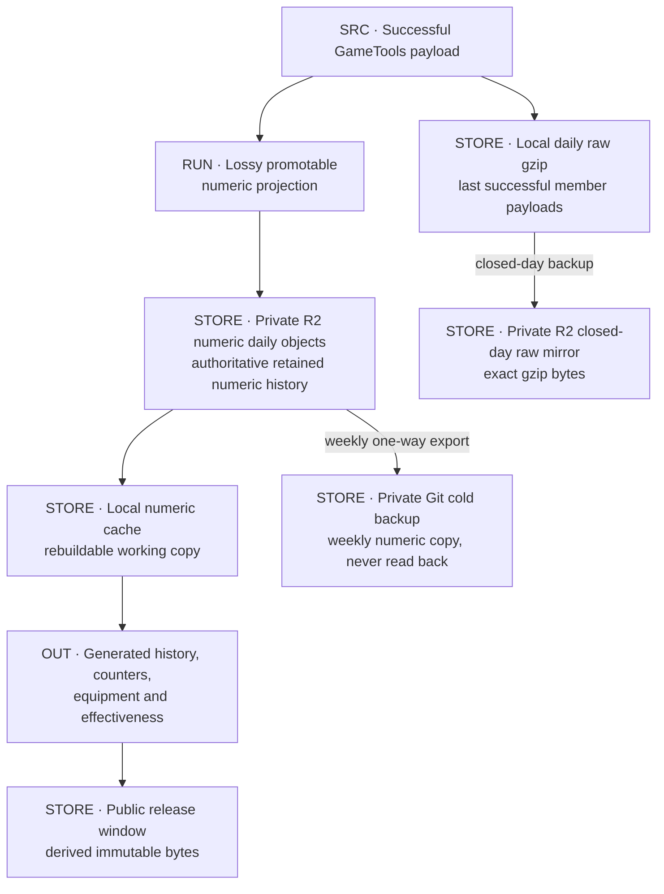
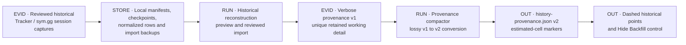
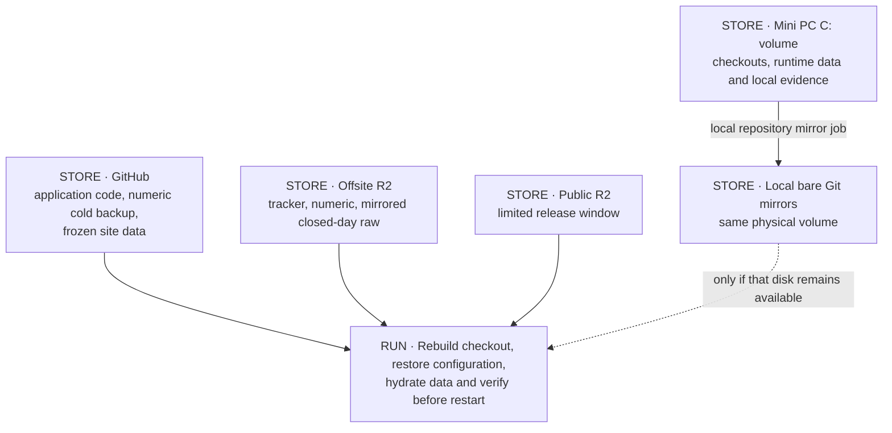

# Archives and durability

[Atlas](README.md) · [Operations](OPERATIONS.md) · [Ownership and retention guide](../BF6_DATA_OWNERSHIP_AND_RETENTION.md)

## D26 · Stores, authority and fidelity

"Raw" means the member payload is stored unprojected. It is not a log of every request: both the raw daily file and the numeric daily object keep the latest successful payload per member per tracker day. The R2 raw mirror is a byte-for-byte copy of the day's gzip, once the upload succeeds.

A closed numeric or raw day in private R2 can still be replaced by a provably newer copy for three days, so a late closing run or a recovered day lands. After that it is sealed and refuses any rewrite. A scheduled run that starts more than an hour late, after its tracker day has closed, is filed under the day it ran in, so it never reopens the previous day.

The large private writes (numeric day, raw day, tracker-state backup) check the private bucket's storage guard first and are refused, not deleted, when they would exceed it.

### Storage register

| Store | Writers → readers | Authority and retention |
|---|---|---|
| Private R2 `tracker-state/current.json` | Registry adapters on the Mini PC and Actions | Live tracker document. Local writes serialized; cross-host writes use ETag CAS |
| Private R2 `tracker-state/backups/YYYY-MM-DD.json` | Daily backup job → operator restore | Immutable UTC-day snapshots, newest seven kept |
| Private R2 `bf6/numeric/daily/<date>.json` | Archive stage → publisher, hydration, export, health | **Authoritative numeric history.** Projected (lossy), kept indefinitely |
| Local `<BF6_NUMERIC_CACHE_DIR>` | R2 hydration and publication → publisher, AI | Working copy, rebuildable from R2 |
| Local `data/bf6-full-archive/<date>.json.gz` | Fresh collection → raw tooling | Unprojected payloads, kept indefinitely. The open day and any upload backlog exist only on this disk |
| Private R2 `bf6/raw/daily/<date>.json.gz` | Closed-day raw backup → recovery and re-audit | Offsite copy of the raw day, kept indefinitely. Mirroring never deletes local files |
| Local `notification-receipts.json` and `latest-collection.json` | Refresh and cached republish | Discord dedup receipts and the last full collection on the Mini PC. No offsite copy |
| Local `publication-state/current-state.json` and generations | Publisher and hydration → publisher, AI | Selects the current local generation. Rebuildable from R2 |
| Public R2 `current.json` and `releases/<id>/` | Publisher → Worker, browser, verifier, retention | Served bytes. Active release plus 60 superseded |
| `kdm-bf6-archive/archive/bf6/` | Weekly Actions cold-backup export → operator verify and restore only | Byte-identical copy of the numeric daily objects, kept indefinitely; days are added or updated, never deleted. Not an authority: the bot never reads it, and it can lag R2 by up to a week |
| `kdm-bf6-rankings/data/` | None | Frozen website data, for rollback; editing it does not change the live site |
| D1 `kdm-web-analytics` | Traffic Worker → dashboard API | Site-traffic aggregates, kept indefinitely |
| AI logs, `local/`, historical capture workspace | Bot, evaluator, operator | Diagnostics and unique evidence. Gitignored, no offsite backup |

The numeric daily objects are the source of truth; the retired `bf6/numeric/inventory.json` is not used. Retired tracker-generation protocols and the old multi-object Actions recovery layout are not recovery paths. Git and dual publication modes were removed from source on 2026-10-16; all publication goes to R2.

The archive repository held the live numeric archive until the 3 September 2026 cutover to private R2. Since 30 October 2026 it receives a weekly one-way copy from R2 again, so the numeric history also sits with a second provider behind a separate credential.

### Coverage

Numeric history starts on 10 July 2026; the first cold-backup copy on 30 October held every day from then, with no gaps. Raw gzip coverage starts on 12 August. For the 33 days from 10 July to 11 August, the projected numeric history is the only record.

Per-item fields widened on 10 August to include cumulative headshot kills, shots hit and fired, equipment time and vehicle-archetype data. Earlier days have no counts for these fields, and a stored percentage cannot be converted back into counts. Later projections can backfill only from retained observations; missing rank is left missing, not interpolated.

## D27 · Historical reconstruction and provenance

The July 2026 Tracker.gg backfill was a one-time reconstruction. Its tooling is in `tools/historical/tracker-backfill/`, outside the npm scripts and the default test suite, and it needs the original local captures to run.

Published `history-provenance.json` (v2) marks estimated cells before the 10 July anchor. The local verbose v1 file also holds source, confidence and grouped-session detail. v1 cannot be rebuilt from v2, so keep the raw captures and the v1 file if the backfill may need re-auditing.

`docs/archive/` holds completed plans, incident evidence, reviews and proposals that were not implemented. The repository's old `backups/` exports (a 10 July snapshot and registry exports, removed 2026-10-30 and still in Git history) and old `state/` directory were historical files, not ongoing backups.

## D28 · Mini PC disk loss

The mirror script keeps bare copies of the bot, rankings and archive repositories, with all refs, under `C:\Bots\backups`. They are on the production disk, and they exclude ignored runtime data, `.env` and credentials.

| Survives disk loss | Lost with the disk |
|---|---|
| Code, frozen site data and the numeric cold backup on GitHub | Open raw day and any unmirrored raw backlog |
| Tracker state, backups, numeric history and mirrored raw days in private R2 | AI logs and usage counters |
| Retained public releases | Notification receipts and the last collection |
| D1 traffic history | Local historical capture workspace and v1 provenance |
| | `.env` and host configuration |

No machine-level backup of `C:\ProgramData` or the checkout is currently confirmed, and no full restore has been tested.

### Recovery sources

| Need | Start from | Do not use |
|---|---|---|
| Rebuild numeric history or counters | Private numeric daily objects, in date order | The archive repository as a live source; it lags R2 |
| Recover numeric days lost from private R2 | The cold-backup copy in the archive repository, uploaded back into R2 first | Days newer than its last weekly run, which it does not hold |
| Recover fields dropped by projection | A raw gzip day, local or mirrored | Public JSON, or dates before raw capture began |
| Retry an incomplete publication | The next scheduled refresh, which runs again from the start | A saved partial run |
| Restore member mappings and registries | A validated tracker daily backup, with controlled writes | Public `latest.json`, which is filtered |
| Recreate a retained public release | That release in R2 | Current formulas run on old inputs, which can produce different bytes |
| Re-audit the pre-tracking backfill | Original captures, manifests and v1 provenance | The published v2 markers |
| Restore site-traffic history | D1 | The BF6 archive |

## Source anchors

[Ownership/retention](../BF6_DATA_OWNERSHIP_AND_RETENTION.md), [tracker document schema](../../src/tracker-state-schema.js), [tracker CAS adapter](../../src/tracker-state-r2-simple.js), [tracker backups](../../src/tracker-state-r2-backup.js), [numeric R2](../../src/bf6-numeric-archive-r2.js), [raw local archive](../../src/bf6-local-full-archive.js), [raw backup](../../src/bf6-raw-archive-backup.js), [bare mirror script](../../scripts/kdm-backup-mirror.ps1), [historical tooling](../../tools/historical/tracker-backfill/README.md), [local evidence inventory](../../tools/README.md), [cold-backup workflow](../../.github/workflows/bf6-numeric-cold-backup.yml), [archive repository README](https://github.com/raymdl/kdm-bf6-archive/blob/2cd402b06cbcbd125a6cbf78b66a0985fb4c657f/README.md).
