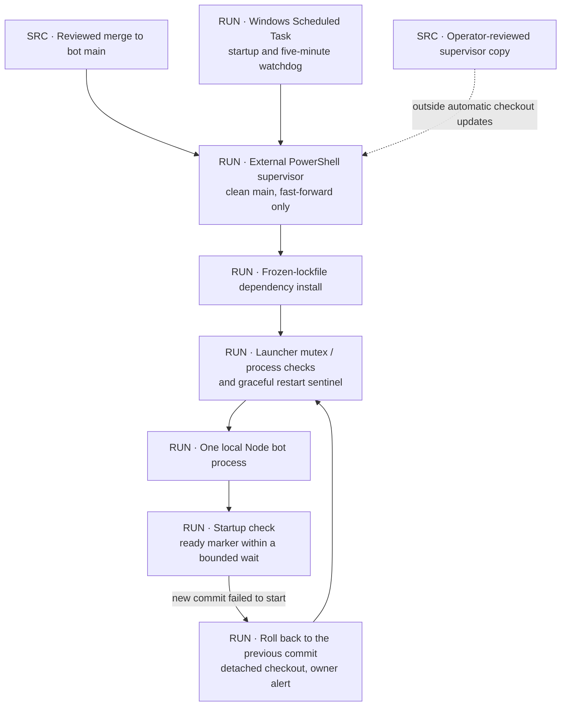
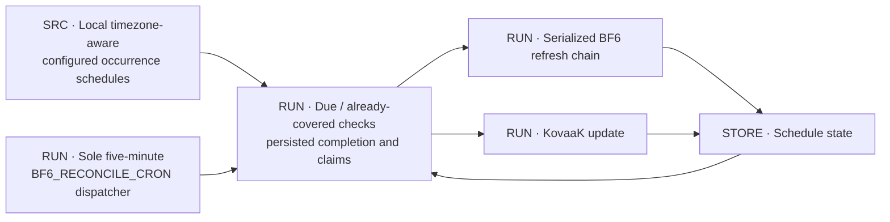
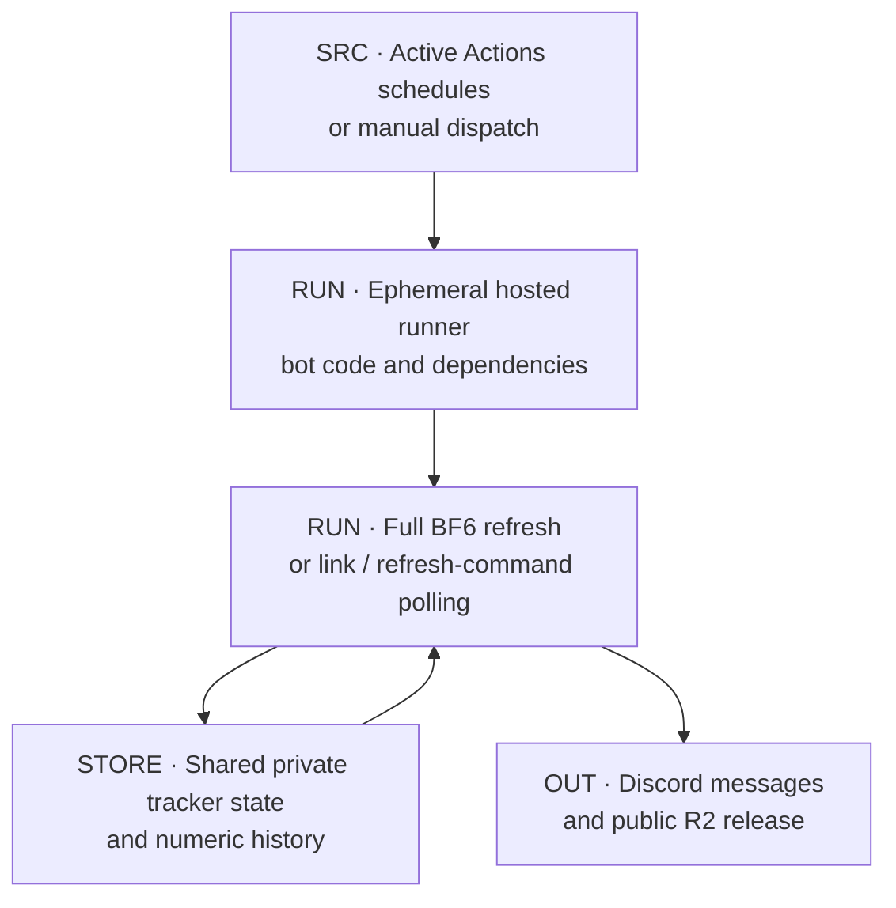
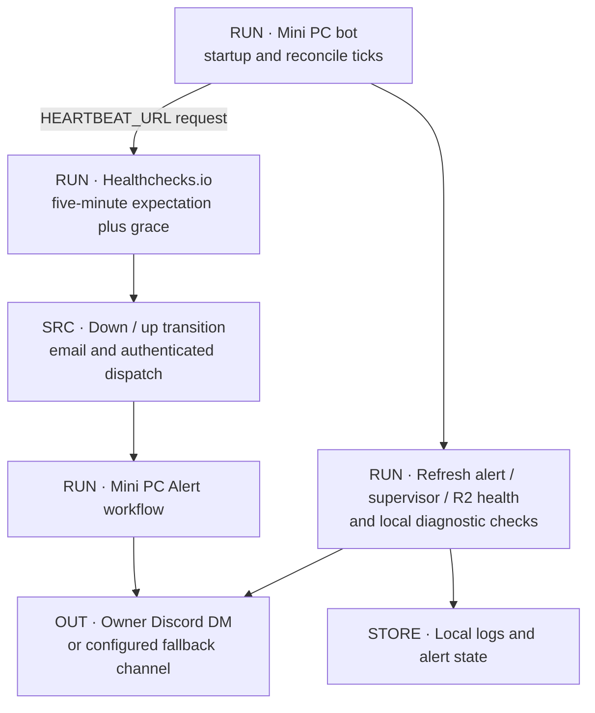
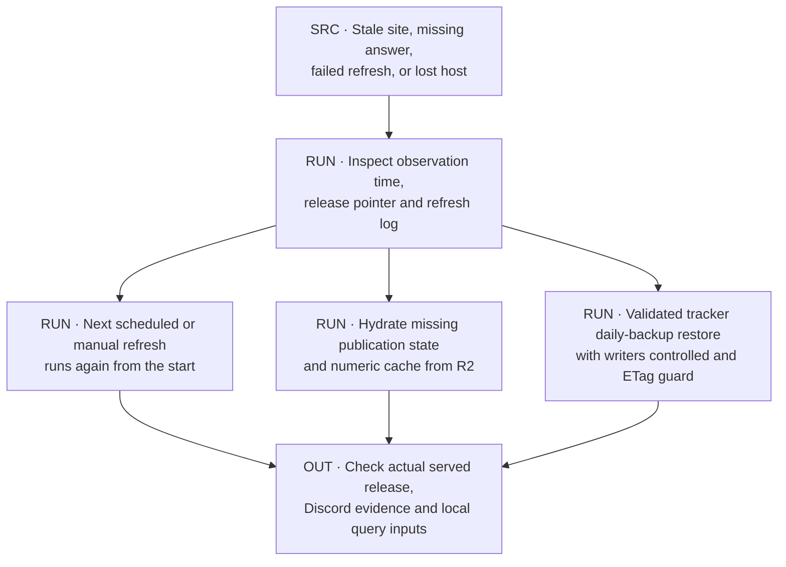

# Operations and recovery

[Atlas](README.md) · [Archives](ARCHIVES.md) · [Change register](REGISTER.md)

## D21 · Code deployment and data publication

Production runs on a headless Windows Mini PC. The main PC is for development only. A Scheduled Task starts the supervisor at boot and every five minutes. The deployed supervisor sits outside the checkout so an update cannot replace it mid-run.

| Location | Purpose |
|---|---|
| `C:\Bots\kdm-discord-bot` | Production checkout |
| `C:\Bots\kdm-bot-supervisor.ps1` | Deployed supervisor; copy changes to it by hand |
| `scripts/kdm-bot-supervisor.ps1` | Tracked source of the supervisor |
| `scripts/start-local-bot.ps1` | Launcher: single-process guards, log rotation, restart handshake, startup check and rollback |
| `C:\ProgramData\KDM\bf6-refresh-pipeline` | Notification receipts, publication generations, last collection, alert state |
| `C:\Bots\kdm-bf6-rankings` | Site checkout; not written in R2 mode |
| `data/bot.log`, `data/bot.err.log`, `data/auto-update.log` | Runtime and deployment logs |

The supervisor updates only a clean `main` by fast-forward, then installs from the frozen lockfile and restarts the bot.

| Condition | Result |
|---|---|
| Fetch fails | Bot keeps running on the current revision |
| Branch diverged or tracked files changed | Update blocked; nothing is reset |
| Dependency install fails | Restart blocked; retried next cycle |
| A just-deployed commit does not reach Discord ready | Previous commit checked out and started; updates pause and the owner is alerted until the checkout is returned to `main` |

The launcher requests a graceful exit through `data/bot-restart-requested`. The bot finishes its current BF6 refresh chain, with a bounded force-stop fallback. A mutex and process checks prevent a second local instance; they do not coordinate with GitHub Actions. The tracked and deployed supervisor copies can drift apart if the deployed copy is not updated after a change.

## D22 · Scheduling by occurrence reconciliation

The bot has one cron job, the five-minute reconcile tick (minute `:02`, `:07`, and so on). The other cron expressions only define when work is due. Each tick runs any due occurrence that has not been completed, so a late tick recovers a missed run.

| Work | Schedule |
|---|---|
| BF6 refresh | 09:00, 13:00, 16:00, then hourly 19:00–01:00 `America/New_York` |
| End-of-day snapshot | 23:45 `America/Los_Angeles`, 15 minutes before the tracker day closes |
| KovaaK | 09:21 `America/New_York` |

Named time zones handle daylight-saving changes. The watchdog task and the reconcile tick are independent: the watchdog keeps the process running; the tick decides refresh work. A running process or a heartbeat does not show that refreshes succeed.

Each scheduled run is filed under the tracker day of its slot. A run that starts more than an hour late, after that day has closed, is filed under the day it ran in instead, so it cannot add the next day's play to the closed day.

A failed refresh is not resumed. A failed scheduled occurrence is retried from the start on the next five-minute tick, until it succeeds or a newer occurrence is due. The first failure does not alert; the second consecutive failure alerts the owner with one message that is edited in place.

## D23 · Actions fallback

GitHub Actions runs scheduled fallback work when the Mini PC has not completed it.

| Workflow | Trigger | Work |
|---|---|---|
| BF6 Fallback Refresh | 05:30, 11:30, 17:30, 23:30 UTC while Check Link Changes is enabled, filed under the slot time unless it starts over an hour late after the day closed; one run when the Mini PC goes down; manual | The same full BF6 refresh as the bot. Scheduled runs proceed only while Mini PC Alert has Check Link Changes enabled |
| Update KovaaK Standings | Daily 13:07 UTC while the Mini PC is down; manual | KovaaK update |
| Check Link Changes | 05:30, 12:05, 17:05, 23:05 UTC while the Mini PC is down; manual | Poll link changes and pending refresh commands, then KovaaK; a link change runs a full BF6 refresh; fingerprints skip unneeded collection |
| Mini PC Alert | `repository_dispatch` down / up | Owner DM, or fallback channel, while the Mini PC is offline; enables or disables the scheduled fallbacks |
| Tests | PRs, pushes to main, manual | Application tests |
| BF6 Numeric Cold Backup | Weekly; manual | Exports the private numeric daily objects and commits new or changed days to the private archive repository, one way ([D26](ARCHIVES.md#storage-register)) |

State-writing workflows other than BF6 Fallback Refresh share the `tracker-state` concurrency group; the fallback refresh has its own group so a queued run is never cancelled. These groups serialize hosted jobs only. Races with the Mini PC are handled per store: tracker-document CAS, per-day numeric CAS with remerge, and public-pointer CAS. There is no system-wide lock.

R2-mode runners do not check out the rankings or archive repositories. Generations and the numeric cache live in runner temp storage, and `state/bf6-refresh-pipeline/` is discarded after the run. Private R2 carries state between runs. Notification receipts are host-local, so Actions runs post no overtake, milestone or digest messages; announcements wait for the Mini PC ([R16](../KNOWN_RISKS_AND_GAPS.md)).

Actions has no gateway connection. While the Mini PC is offline there are no AI replies and no live speedrun edit or delete handling; those catch up after restart.

## D24 · Monitoring

The bot pings Healthchecks.io every five minutes. With a 15-minute grace period, a down alert arrives about 20 minutes after the last ping. Healthchecks sends one email and one `repository_dispatch` per state change; the Mini PC Alert workflow turns the dispatch into a Discord DM. Setup and credentials are in the [Mini PC guide](../MINI_PC_OPERATIONS.md).

Inside the bot:

- Bounded tails of the supervisor log are checked, and a deploy rollback keeps an owner alert open until it is cleared.
- Refresh failures alert the owner after two consecutive failures.
- R2 health runs about 17 minutes after startup and then every six hours. It reports storage use, growth, numeric coverage and raw-upload backlog. It does not delete anything.
- Event-loop lag is logged, not alerted.

## D25 · Recovery

| Failure | Recovery |
|---|---|
| Refresh failed | Nothing is resumed; the next scheduled refresh or a manual run starts over |
| Local publication generation missing | Hydrate from the active public release |
| Local numeric cache lost | Hydrate from private daily objects |
| Private numeric days lost or damaged | Upload them back from the weekly cold backup in the archive repository, then hydrate as above |
| New deploy fails to start | The launcher has already restarted the previous commit; fix `main`, return the checkout to `main` and clear the rollback marker ([Mini PC guide](../MINI_PC_OPERATIONS.md)) |
| Registry damaged | Restore a validated daily backup with writers stopped and a known current ETag; follow the [R2 operations runbook](../BF6_R2_OPERATIONS_RUNBOOK.md) |

Corrupt or incomplete required history fails the run instead of starting an empty history.

| Command | Effect |
|---|---|
| `ops:bf6-r2-health` | Storage and coverage report |

A fresh publish dry run still calls GameTools. A cached site-only publish skips collection but still publishes.

### Credentials

The Mini PC and Actions each have their own public-publisher credentials and separate private-bucket credentials. The delivery Worker has no private-bucket binding. The cold backup writes to the archive repository with a token scoped to that repository only. The AI service holds a model API key only. Traffic Command holds its analytics token and sync secret server-side. The bare Git mirrors do not include `.env`, `.dev.vars` or other credentials.

## Source anchors

[Host supervisor](../../scripts/kdm-bot-supervisor.ps1), [launcher](../../scripts/start-local-bot.ps1), [gateway and dispatcher](../../src/index.js), [schedule reconciliation](../../src/schedule-catchup.js), [BF6 refresh](../../src/bf6-refresh.js), [heartbeat](../../src/mini-pc-heartbeat.js), [supervisor health](../../src/supervisor-health.js), [R2 health](../../src/bf6-r2-health.js), [offline alert sender](../../src/mini-pc-actions-alert.js), [BF6 fallback](../../.github/workflows/bf6-fallback-refresh.yml), [combined poll](../../.github/workflows/check-links.yml), [offline alert workflow](../../.github/workflows/mini-pc-alert.yml), [numeric cold backup](../../.github/workflows/bf6-numeric-cold-backup.yml).

Guides: [Mini PC](../MINI_PC_OPERATIONS.md), [Actions](../GITHUB_ACTIONS.md), [publication recovery](../BF6_PUBLICATION_RECOVERY_RUNBOOK.md), [R2 operations](../BF6_R2_OPERATIONS_RUNBOOK.md), [development](../DEVELOPMENT.md), [configuration](../CONFIGURATION.md).
