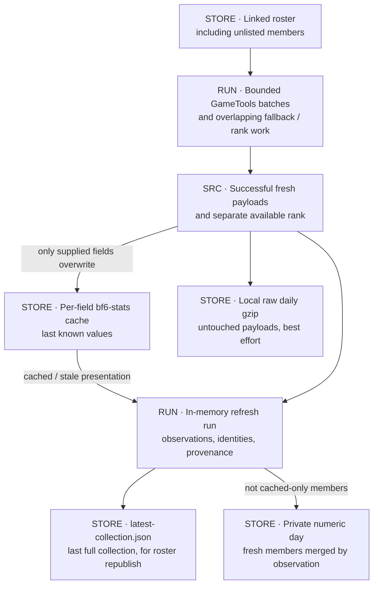
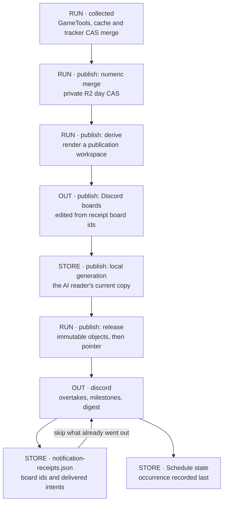
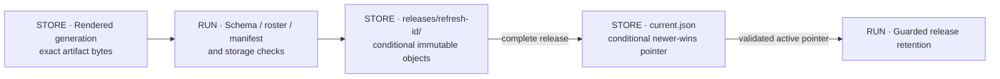
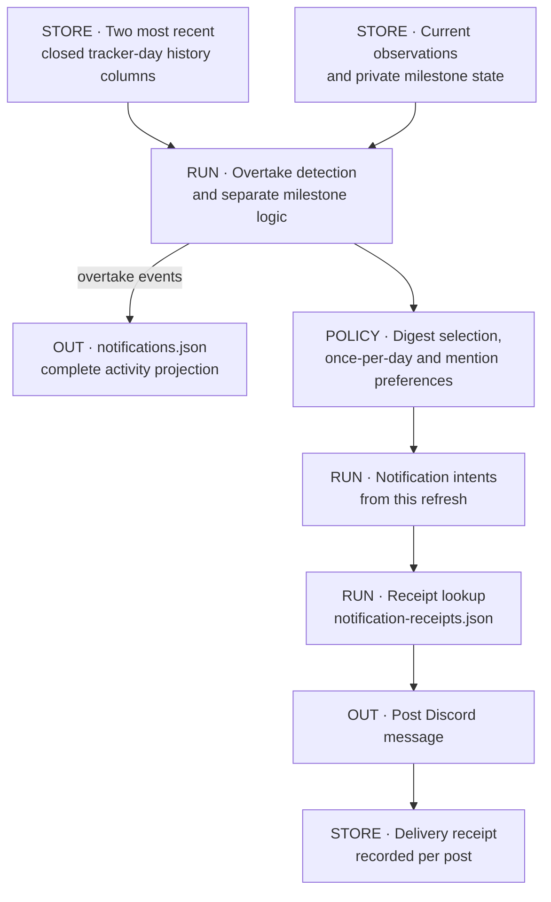
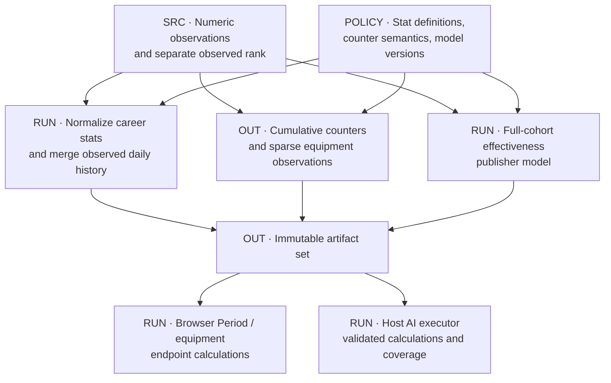

# Refresh, calculations and publication

[Atlas](README.md) · [Archives](ARCHIVES.md) · [Recovery](OPERATIONS.md)

## D07 · Fresh observations and cached presentation

Each batch entry carries the verified player ID, account ID and identity platform. Defaults are ten members per chunk and two chunks in flight. Requests use `format_values=true` because unformatted batch responses were unreliable upstream; normalization converts the values back to numbers. A hard deadline bounds the batch stage. Fast retryable failures retry within that deadline; timeouts do not. Members that fail, are missing or return invalid data fall back to individual requests. Profile rank is a separate request, and a rank failure does not discard the member's statistics.

The presentation cache and the archive treat failures differently:

- **Presentation cache.** Fresh fields replace cached fields. Missing fields keep their last value. A member whose fetch failed entirely still appears, flagged stale.
- **Numeric archive.** Only fresh payloads are archived. Within a tracker day, the newest successful payload per member wins, and a later failure does not remove an earlier success. A refresh with no fresh payloads writes nothing.
- **Raw archive.** Written best effort and monitored separately. A successful public refresh does not confirm that raw capture or its offsite mirror succeeded. A closed raw day stays replaceable by a provably newer local copy for three days, as the numeric day does, and is sealed after that.

## D08 · One idempotent refresh

`refresh({ trigger, scheduledFor })` in `src/bf6-refresh.js` runs these steps in order, every time, from the start. Nothing is resumed. A failure at any step is logged, the run stops and returns `{ ok: false, stage, error }`, and the next five-minute reconcile tick (for a scheduled occurrence) or the next scheduled refresh runs the whole thing again. The boards and the local generation update before the public upload, so an R2 outage leaves members current boards and AI answers while the site stays on the last release; a board failure does not hold back the upload and fails the run afterwards. That rerun is safe because:

- the numeric day and tracker state are CAS merges in private R2;
- release objects are immutable and the pointer only moves forward;
- Discord posting is deduplicated by `notification-receipts.json`: the board message ids live there, and each overtake, milestone or digest post is recorded as soon as it is sent.

A run reports three stages (`collected`, `publish`, `discord`) to the `!bf6-refresh` progress message. Site-only runs and the Actions link check skip parts of the Discord stage. Alerts fire only after two consecutive failures and edit one message rather than posting again; a success resolves it. There is still no transaction across Discord, both R2 buckets and the two hosts.

`r2` is the only publication mode. The Git and dual modes, Pages verification, the Git numeric archive and its shadow writer were removed on 2026-10-16. The resumable stage pipeline, its envelope outbox, `pipeline-state.json`, private recovery bundles and the delivery Worker read-back stage were removed later the same day.

The roster republish (after a roster change) reads `latest-collection.json` and runs only the publish half, without a numeric merge or notifications.

## D09 · Release publication

Objects are created with `If-None-Match: *`. Re-uploading identical bytes to an existing key succeeds as a retry; different bytes are rejected as a collision. The pointer update is a CAS, so concurrent publishers cannot move it backwards, and it moves only after every object in the release has uploaded. Before upload, the release is checked against the listed-member set to catch a partially filtered roster. A failed upload leaves the pointer on the previous release; the next refresh renders and uploads a new release id.

Retention keeps the active release and 60 superseded releases (`BF6_R2_KEEP_SUPERSEDED_RELEASES`; the source default matches). Deletion stops if the pointer is unreadable or inconsistent, and releases newer than the pointer snapshot are protected from a concurrent pass. There is no read-back verification stage and no automatic rollback; [BF6 R2 operations](../BF6_R2_OPERATIONS_RUNBOOK.md) covers checking a release by hand.

## D10 · Overtakes, milestones and delivery

Overtakes compare the two most recent closed tracker days, not intraday refreshes. The first full refresh observed at or after 9 AM in `UPDATE_TIMEZONE` announces the previous day's net movement; an earlier refresh leaves the closed day pending. New entrants do not count as overtakes. Every site-tracked stat feeds the Activity page. The Discord digest picks at most four overtakers by impact and rivalry rules, and never headlines Time Played or bot-inclusive K/D. Mute removes the tag only.

Each refresh derives its notification intents again; intents are not saved between runs. Delivered intent ids from `notification-receipts.json` are passed to the renderer, and the sender skips any intent that already has a receipt. Channel history is never searched for markers. Posting and recording the receipt are two separate operations, so if the process stops between them the next refresh posts a duplicate. The receipts are local to the host that posted, so Actions runs, whose receipts last only for the run, post no overtake, milestone or digest messages (see R16 in [known risks](../KNOWN_RISKS_AND_GAPS.md)). Milestone state and announcement receipts are stored privately, separate from public release retention.

## D11 · Calculations and their consumers

### Artifact contract

Paths are relative to the generated `data/` directory. The website strips its logical `data/` prefix when it resolves a URL inside an R2 release.

| Artifact | Contents | Main consumers |
|---|---|---|
| `meta.json` | Ordered stat definitions; refresh, observation and generation timestamps | All website routes, AI reader, verification |
| `latest.json` | Listed members, identities, profile links, current values, stale flags | Standings and profiles; AI identity catalogue and current values |
| `history.json` | Dense daily per-member stat values | Charts, closed-day overtakes, AI context |
| `counters.json` | Versioned cumulative counts with current-day metadata | Browser and AI Period calculations |
| `equipment-catalogue.json` | Optional item labels and categories | Equipment views, AI item resolution |
| `equipment-index.json` | Optional current equipment summaries | Career equipment views, AI current-item values |
| `equipment/<discord-id>.json` | Optional sparse equipment change points | Lazy per-player equipment history and Period views |
| `effectiveness-history.json` | CEI, RAIS, WRR and component series plus current snapshot, computed by the publisher | Effectiveness Lab (the browser does not recompute) |
| `audit.json` | Filtered administrative and link history | Audit route |
| `notifications.json` | Overtake activity and public receipt state | Activity, rivalry context, notification bookkeeping |
| `history-provenance.json` | Compact v2 markers for estimated pre-tracking history | Dashed history and Hide Backfill |
| Release manifest / `current.json` | Integrity data and release selection | Publisher, verification, retention; the browser reads the pointer |

### Numerical rules

- `BF6_STAT_CONFIG` defines the stats and their order.
- Player KPM is human-player kills divided by active class-All minutes. It differs from the upstream kills-per-minute value. Score/min and time played use the same active-time basis.
- Player K/D excludes bot kills; a separate K/D Ratio includes them. Weapon headshot percentage is separate from all-kill counts.
- A rank of zero means unavailable and is stored as missing.
- Period values are differences of cumulative counters (for example, change in human kills divided by change in deaths), not the change in lifetime K/D and not an average of daily ratios. Missing observations, carried endpoints, tracking-start limits, zero denominators and resets each have explicit handling.
- Rate stats need **15 active minutes per calendar day** of the resolved window to rank on the website. Count stats have no threshold. Player Rank is Career-only.
- A run scheduled exactly at midnight `America/Los_Angeles` is filed under the day that just ended, so it supplies that day's closing values. If it fails, the previous run's values stand.
- A scheduled run keeps its slot's tracker day unless it starts more than an hour late after that day has closed; then it is filed under the day it ran in, and the closed day keeps its last on-time values. The numeric day, raw gzip and generated history use the same date.
- Tracker days begin at midnight `America/Los_Angeles`, whatever names such as `easternDateKey` or the counters `timezone` field suggest. Today-so-far comes from `current.settled` and the artifact date axis, not the browser clock.

Consumers check for the keys each stat needs, so a counter formula-version bump alone does not disable Period views. Renaming a key breaks consumers visibly. Changing a key's meaning while keeping its name breaks them silently, because structural checks cannot detect it. Effectiveness formula changes need a model-version and fingerprint rebuild. See the [change register](REGISTER.md#change-register).

## Source anchors

[Collection/cache](../../src/bf6-cache.js), [refresh](../../src/bf6-refresh.js), [numeric R2](../../src/bf6-numeric-archive-r2.js), [raw local writer](../../src/bf6-local-full-archive.js), [site publisher](../../src/bf6-site-publish.js), [publication state](../../src/bf6-publication-state.js), [R2 publisher](../../src/bf6-r2-publish.js), [pointer](../../src/bf6-r2-pointer.js), [retention](../../src/bf6-r2-retention.js), [notification receipts](../../src/bf6-notification-receipts.js), [stat definitions](../../src/bf6-format.js), [counters](../../src/bf6-counters.js), [effectiveness](../../src/bf6-effectiveness.js).

Guides: [publication](../BF6_PUBLICATION.md), [data ownership](../BF6_DATA_OWNERSHIP_AND_RETENTION.md), [Period semantics](https://github.com/raymdl/kdm-bf6-rankings/blob/94af6b1a2e9c87c917153d591da5b13ffbe184c0/docs/PERIOD_VIEWS.md).
